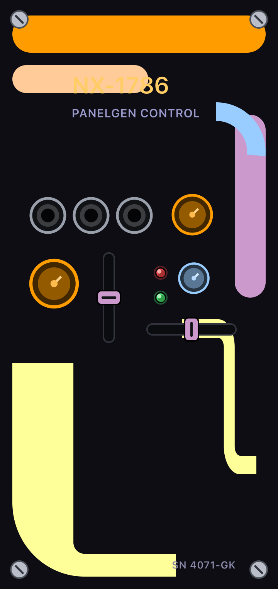

# PanelGenerator

**A native macOS editor for designing VCV Rack front panels — with a Star Trek:
TNG / LCARS soul.**

Filled curved shapes are first-class citizens: LCARS elbows, sweeping ring
sectors, and per-corner-radius boxes (pills & capsules) sit right next to the
synth primitives — jacks, rotating knobs, and faders — in a drag-and-drop
repository. Colours are edited with the **native macOS colour picker**
(`NSColorWell`), backed by a curated Okudagram swatch bank.



## Features

- **Panels in HP × U** — width in HP, height 1U or 3U, using VCV Rack's SVG
  conventions (1 HP = 15 px, 3U = 380 px, 1U = 127 px) so exports drop
  straight into Rack-sized layouts.
- **Drag-and-drop repo** — jacks, knobs (L/M/S with rotatable pointer),
  vertical/horizontal faders, LEDs, screws, text labels; plus the shape kit:
  box (per-corner radii), ellipse, triangle, LCARS elbow (thickness, inner
  radius, arm lengths, mirror/flip), ring sector (start/sweep/thickness).
- **Real editing** — click / shift-click / marquee selection, move & resize
  with HP-grid snapping, rotation, z-order, duplicate, delete, full undo/redo,
  zoom (fit / actual / in / out).
- **One vector truth** — canvas, PNG and SVG all consume the same `CGPath`
  data; exports can never drift from what you see.
- **Export** — SVG (vector, Rack-compatible px space) and PNG at 4×
  (720×1520 for a 12HP 3U panel). Text exports as **glyph outlines** by
  default: VCV Rack parses SVG with nanosvg, which has no text support and
  drops `<text>` silently, taking every label with it. Turning *Text ▸ Export
  as outlines* off emits editable `<text>` instead, for handing a panel to
  Illustrator / Inkscape.
- **Documents** — JSON `.panelgen` files; Open/Save/Save As with dirty-state
  prompts.
- **Stamps** — save any selection to the palette (*Edit ▸ Add Selection to
  Palette…*) and drop it on the next panel. A stamp carries shapes and sizes,
  never identity: identifiers, groups and label bindings are stripped, so two
  panels can never end up claiming the same enum name. They live in
  `~/Library/Application Support/PanelGenerator/Stamps` as plain JSON; the
  ones in `Stamps/` here are installed on first launch.
- **Manual** — *Help ▸ PanelGenerator Manual* (⌘?) opens `Docs/Manual.html`:
  the whole loop from a blank panel to a compiling module.
- **Headless smoke test** — `PanelGenerator --selftest [dir]` renders a
  showcase panel to SVG+PNG without a window server.

## Build & run

Requires macOS 13+ and Xcode command line tools.

```bash
make run        # build debug + launch the editor
make app        # build release + assemble PanelGenerator.app, then: open PanelGenerator.app
make test       # unit tests (swift test)
make selftest   # headless render test → Docs/pg_demo.{svg,png}
```

Or plain SPM: `swift build && .build/debug/PanelGenerator`.

## Documentation

**[Docs/Manual.html](Docs/Manual.html)** is the manual — also *Help ▸
PanelGenerator Manual* (⌘?) in the app. It covers the window, grids and guides,
labels and module titles, components, the design languages (Paperface
included), stamps, importing, emitting and wiring the C++, `--compare`, the
command line and the keyboard shortcuts.

Developer references, for working on PanelGenerator itself:
[PIPELINE.md](PIPELINE.md) (the panel ↔ code contract),
[Docs/SYMBOLS.md](Docs/SYMBOLS.md) (symbol catalogue),
[Docs/PAPERFACE.md](Docs/PAPERFACE.md) (Paperface grid, glyphs, lamps, toggle).

## Architecture

```
Model (value types, JSON)           Geometry: 1HP=15px · 3U=380px · 1U=127px
  PanelDocument → [PanelElement]
        │
        ▼
Renderer — parts(for:) -> [ShapePart(CGPath, fill, stroke)]   ← single source of truth
        ├── CanvasView        interactive AppKit surface + overlays
        ├── PNGExporter       CGContext over NSBitmapImageRep, 4×
        └── SVGExporter       CGPath → <path d="…"> walker (PathSVG)
```

Source layout — three targets (see `Package.swift`):

```
Sources/PanelKit/            library: everything that does not need a window
  Model/                     ColorSpec, formats, component binding, ElementKind,
                             ElementParams, PanelElement, PanelDocument (+Fitting,
                             +Labels, +Widgets, +Editing, +Persistence), Decoding
  Render/                    Renderer: drawing, path builders, parts, text outlines
  Styles/                    one file per design language: DesignLanguage (registry,
                             swatch bank, presets), Generic, Kurkesmurfer,
                             Serge (+Grid), LCARS (+Paths)
  Symbols/                   symbol catalogue + one file per category
  Geometry, PathSVG, SVGPath, SVGImport, CppImport, CodeGen, Compare, Emit,
  Exporters, Stamps, Selftest
Sources/PanelCanvas/         the editing surface, its own module so gesture,
  CanvasView(+Clipboard,     handle and snapping state stay internal; the editor
  +Commands, +Drawing,       sees only its `package` API
  +Handles, +Mouse, +DragDrop)
Sources/PanelGenerator/      AppKit editor + command-line front end (main.swift)
  InspectorView(+Panel, +Element, +Params, +Component, +Prompts, +Layers)
  MainWindowController(+File, +Import, +Export, +Edit, +View, +Stamps, +Menus)
  PaletteView, LayerListView, SymbolPicker, AppDelegate
Tests/PanelKitTests/         XCTest — `make test` or `swift test`
```

A new house style is one file in `Styles/` plus one line in
`DesignLanguage.all`: its swatches join the inspector's bank and its palette
section appears in the repo.

Cross-target API uses Swift's `package` access level, so nothing is exposed
outside this package.

## Status & roadmap

This is a **prototype** (see `PLAN.md` for the phase log and deliberate
simplifications). Done since the first cut: multi-select align/distribute
(selection bounds + panel-relative), layer list with hide/reorder, and
group/ungroup. Next up, in rough order: freeform bezier shape authoring
with draggable control points, panel templates, and NSDocument migration
(autosave + versions).

## License

MIT — see [LICENSE](LICENSE).
